# Joe Next

基于 [Joe3](https://github.com/jiewenhuang/halo-theme-joe3.0) 重构的 [Halo](https://www.halo.run/) 2 博客主题。保留 Joe 的样子和功能，前端用 Astro + TypeScript 重写：不再依赖 jQuery，页面之间无刷新切换，深浅色、手机端和无障碍都重新做过一遍。

> 本主题由 Joe3 衍生，已获得原作者授权。Joe3 的前身为 qinhua 的 halo-theme-joe2.0。

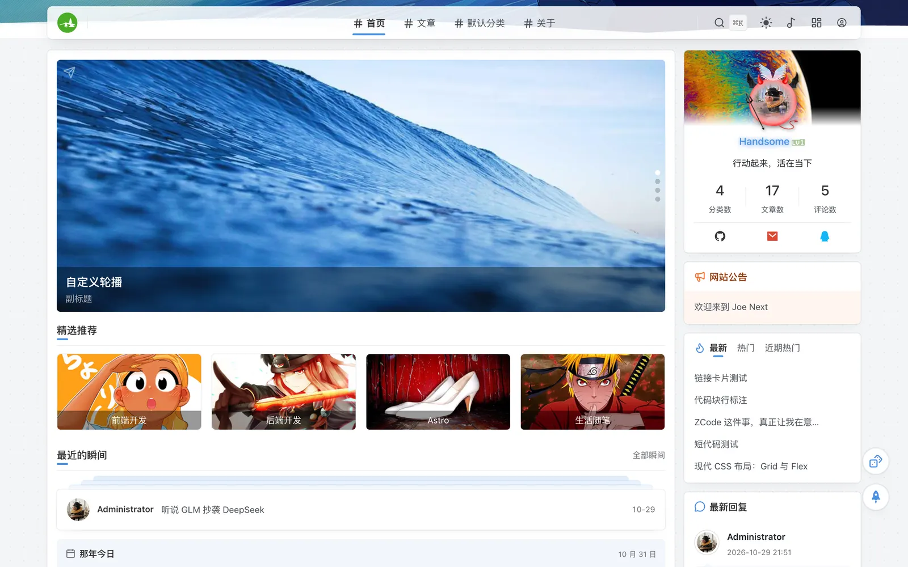

<table>
  <tr>
    <td width="50%">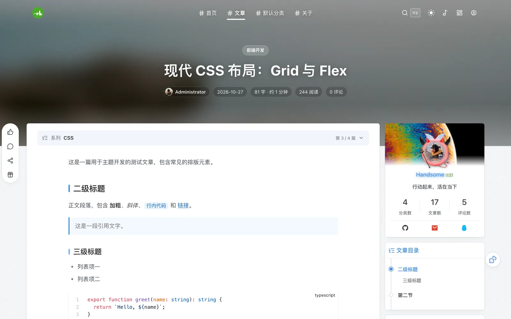</td>
    <td width="50%">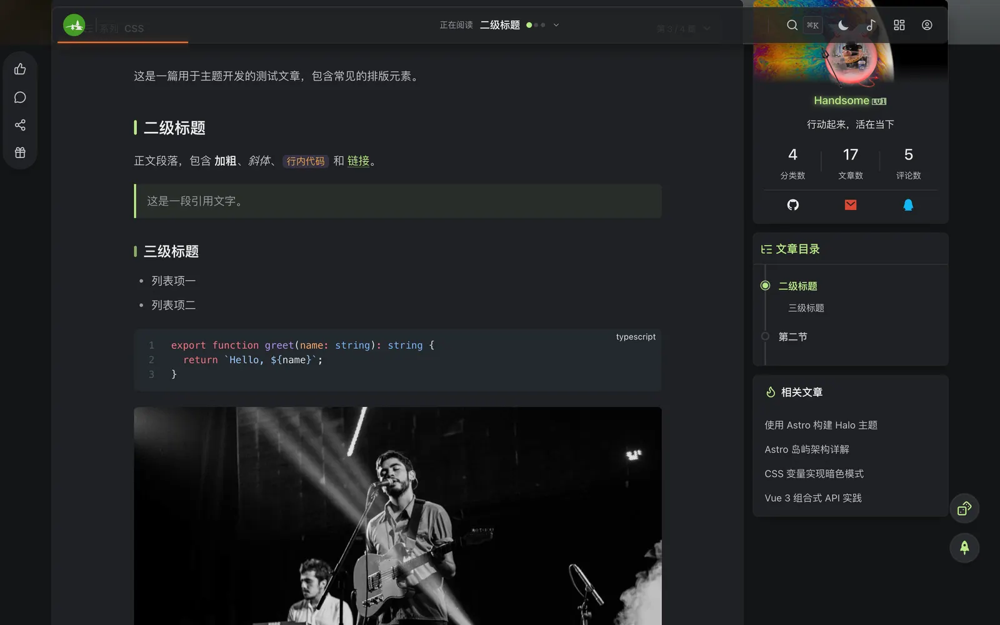</td>
  </tr>
  <tr>
    <td>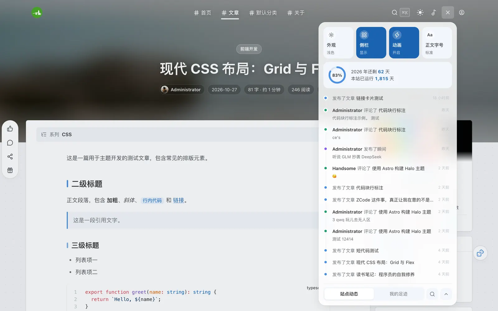</td>
    <td>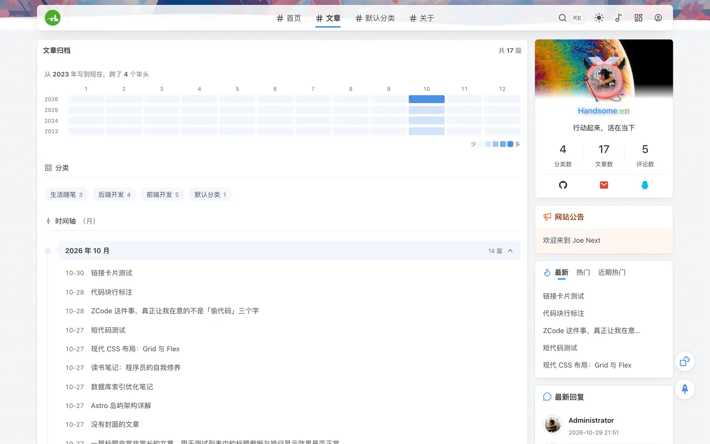</td>
  </tr>
  <tr>
    <td>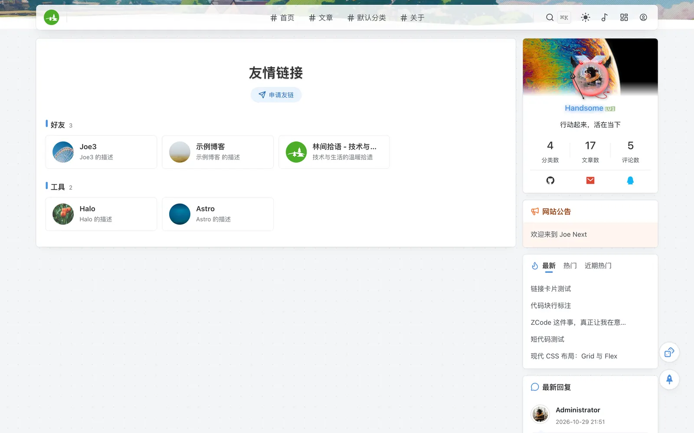</td>
    <td>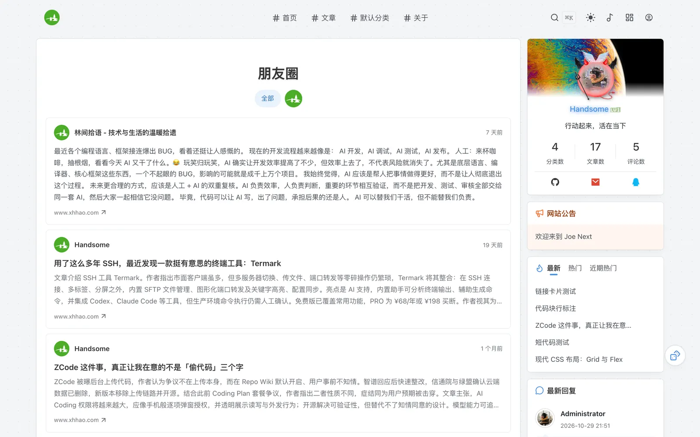</td>
  </tr>
  <tr>
    <td>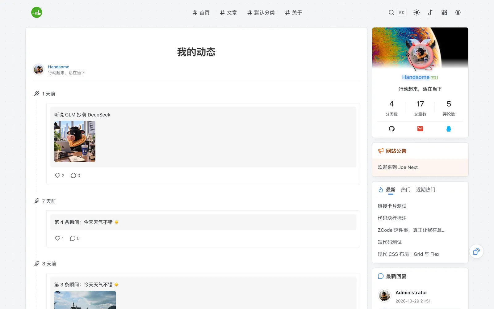</td>
    <td>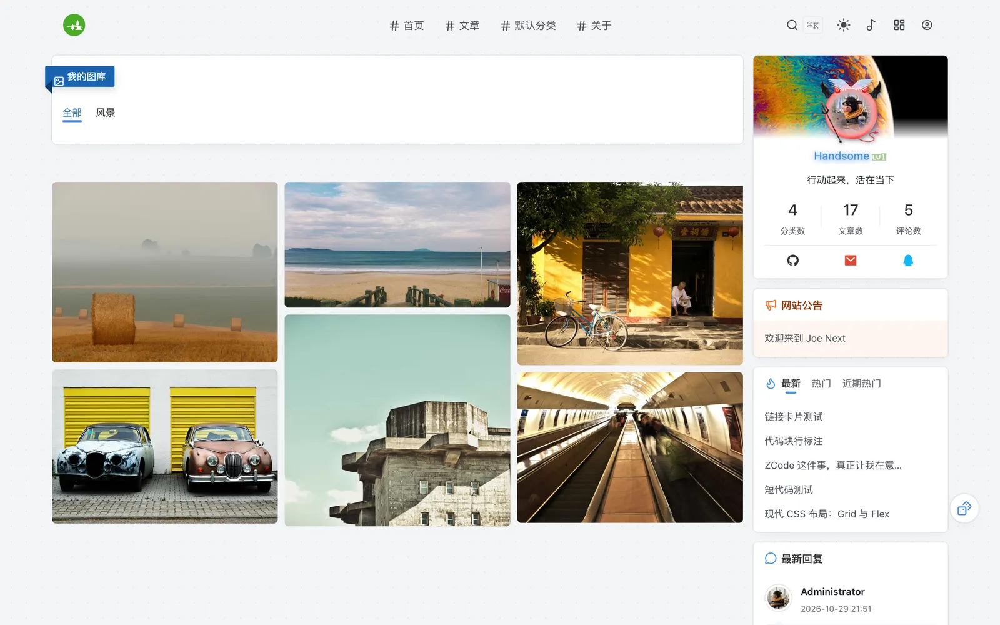</td>
  </tr>
</table>

<p align="center">
  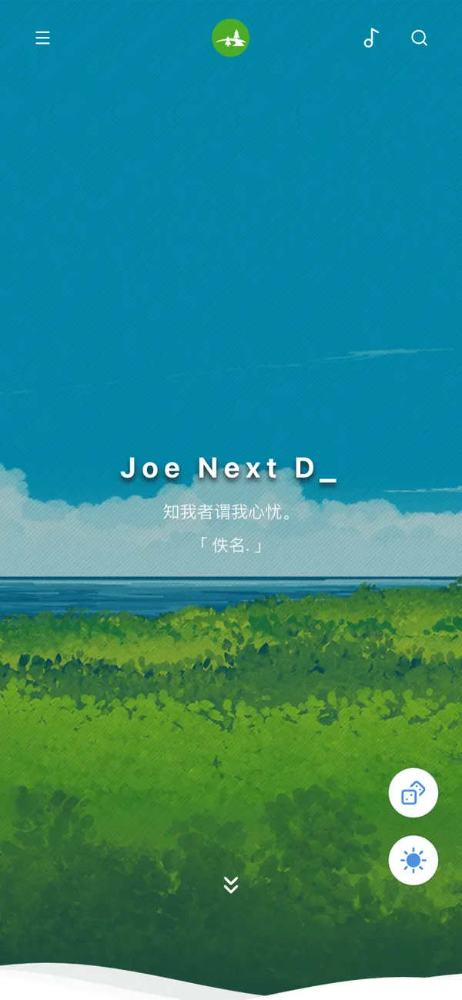
  &nbsp;&nbsp;
  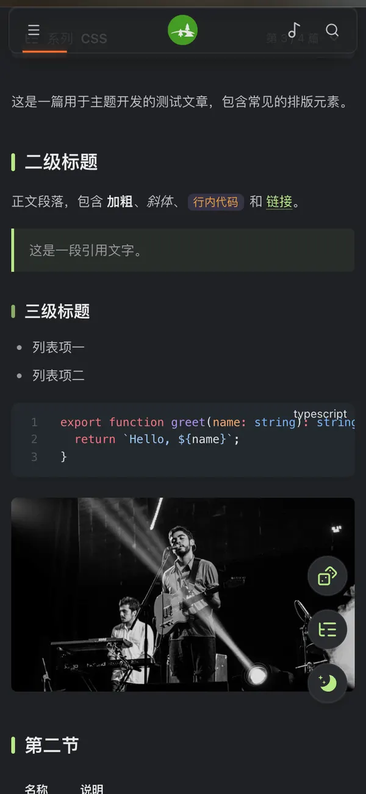
</p>

## 功能

**页面与浏览**

- 无刷新切换页面（swup），支持浏览器原生的过渡动画；导航、音乐播放器在切页时不中断
- 浮岛式导航：阅读文章时显示当前章节与阅读进度，点开就是迷你目录
- 控制中心：一键切换深浅色、侧栏、动画和正文字号，另有站点动态时间线与「我的足迹」（读过的文章、自己的评论，只保存在访客浏览器里）
- 深色模式可以由访客自己切换（默认跟随系统），也可以按时段自动切换，或固定为浅色 / 深色
- 音乐播放器：歌单可以自己上传，也可以用网易云歌单；支持歌词、播放顺序和锁屏控制
- 随便看看、键盘快捷键（`j` / `k` 切换上一篇下一篇，`?` 查看全部）、自定义右键菜单

**首页**

- 全屏大图与一言、轮播、精选推荐、瞬间叠放卡片
- 文章列表：左图右文的列表或双列卡片，按分类标签页切换，加载更多（可滚动到底自动加载）或分页
- 继续阅读（回到上次读到的位置）、新文章与更新标记、卡片上的评论者头像
- 那年今日：往年今天写过的文章

**文章**

- 沉浸式头图、文章目录、字数与阅读时长、过期提醒
- 文章系列：选几个标签当系列，文章顶部显示「第 n / 共 N 篇」和整个系列的目录
- 代码块：语言标签、复制、行号、长代码折叠（语法高亮由 shiki 插件负责）
- 选中文字后可以复制、引用到评论或分享；点赞、打赏、分享海报
- 上一篇 / 下一篇卡片、相关文章、版权信息

**其他页面**

- 归档：时间轴与发文热力图，支持按年、按月查看
- 分类、标签：卡片或标签样式
- 瞬间、图库、友情链接（带访客申请）、朋友圈（订阅友链的 RSS）、装备、留言板

**站点**

- 页脚：运行天数、建站纪念进度、站点数据、导航分组、备案号
- SEO / GEO：canonical、Open Graph / Twitter 分享卡片、JSON-LD 结构化数据、RSS 订阅发现，每项都能单独关闭，方便和 SEO 插件共存
- 性能：首屏只加载必需的样式和脚本，特效、轮播、灯箱等按需下载；图片使用 Halo 生成的缩略图

## 安装

需要 Halo `2.22.8` 或更高版本。

1. 在 [Releases](https://github.com/acanyo/theme-joe-next/releases) 下载最新的 `theme-joe-next-<版本>.zip`
2. 在 Halo 控制台的「主题」页面点右上角「主题管理」，再点「安装主题」上传 zip 文件，安装后启用
3. 主题详情页里「详情」后面的标签页就是主题设置，分为外观、导航、动效与特效、首页、博主卡片、侧边栏、文章、分享与打赏、代码块、页面、SEO、页脚与高级 12 个分组

**升级**：在主题详情页右上角的 `···` 里选「升级」，上传新版本的 zip，已保存的设置不会丢。新版本增加了设置项时，再选一次「重载主题配置」。

**从 Joe3 迁移**：设置项已经重新整理，与 Joe3 不兼容，启用后需要重新设置一遍。Joe 编辑器插入的正文短代码（标签页、提示框、卡片等）不再支持，旧文章里的这些内容会按普通文字显示。

## 推荐插件

主题不依赖任何插件也能运行；装上对应插件后，相应的功能和页面才会出现。

| 功能                                | 插件                                             | 说明                                                                |
| ----------------------------------- | ------------------------------------------------ | ------------------------------------------------------------------- |
| 评论                                | 评论组件（`PluginCommentWidget` 或 CommentNext） | 主题已适配两者的配色                                                |
| 搜索                                | 搜索组件 `PluginSearchWidget`                    | 导航搜索按钮与 `⌘K` / `Ctrl K`                                      |
| 代码高亮                            | 代码高亮 `shiki`                                 |                                                                     |
| 瞬间 `/moments`                     | 瞬间 `PluginMoments`                             | 首页瞬间卡片也需要它                                                |
| 图库 `/photos`                      | 图库 `PluginPhotos`                              |                                                                     |
| 友情链接 `/links`、「友链」页面模板 | 链接 `PluginLinks`                               | 访客申请友链需要插件 2.3.0 以上，并在插件设置里开启「启用友链申请」 |
| 「朋友圈」页面模板                  | 链接 `PluginLinks`                               | 在插件设置里开启「公开 RSS 订阅动态」                               |
| 装备 `/equipments`                  | 装备管理 `plugin-equipment`                      |                                                                     |
| RSS、订阅地址发现                   | RSS `PluginFeed`                                 |                                                                     |
| 超链接卡片                          | `editor-hyperlink-card`                          | 卡片配色跟随主题                                                    |

**页面模板**：在「页面」里新建页面，模板选择「留言板」「友链」或「朋友圈」，例如把别名设为 `friends` 就能通过 `/friends` 访问朋友圈。

**上线前**：确认 Halo 的外部访问地址（启动参数 `halo.external-url`，见 Halo 文档的[配置参考](https://docs.halo.run/guide/install/config)）是正式域名。规范链接、分享卡片和结构化数据里的地址都按它生成。

## 开发

开发环境：Node.js `22.23.4`（见 `.nvmrc`）、pnpm `10`。

```bash
nvm use
pnpm install
pnpm dev        # 监听 src/ 变化并重新构建到 templates/
```

将主题目录放到 Halo 工作目录的 `themes/theme-joe-next/`，在控制台安装并启用。开发时建议关闭模板缓存：`SPRING_THYMELEAF_CACHE=false`。

| 命令                     | 作用                                                   |
| ------------------------ | ------------------------------------------------------ |
| `pnpm build`             | 构建模板并打包为 `dist/theme-joe-next-<version>.zip`   |
| `pnpm build:templates`   | 仅构建模板到 `templates/`（开发调试用）                |
| `pnpm check`             | TypeScript / Astro 类型检查                            |
| `pnpm test`              | 单元测试                                               |
| `pnpm settings:defaults` | 修改 `settings.yaml` 后重新生成设置项默认值            |
| `pnpm qa:size`           | 首屏 CSS / JS 与主题包体积预算（CI 中运行）            |
| `pnpm qa:shots`          | 各页面明暗 × 桌面 / 手机全页截图，检查状态码和脚本错误 |
| `pnpm qa:snapshot DIR`   | 计算样式快照；`pnpm qa:diff A B` 对比两次快照          |
| `pnpm qa:a11y`           | axe-core 无障碍检查（WCAG 2 A / AA）                   |

`qa:shots`、`qa:snapshot`、`qa:a11y` 需要一个启用了本主题的 Halo（默认 `http://127.0.0.1:8091`，用 `HALO_URL` 修改）和本机 Chrome；`ROUTES`、`WIDTHS` 环境变量可限定页面与宽度。重构样式时先对修改前后各拍一次快照再对比，可发现肉眼难以察觉的样式变化。

发布：在 GitHub 创建 Release 后，CD 工作流会自动构建并把主题包上传到 Release 附件。

### 目录结构

```
src/
├── pages/              页面模板，每个文件对应一个 Halo 模板（index、post、archives…）
├── layouts/            BaseLayout：head、导航、页脚、悬浮按钮、全局脚本
├── components/
│   ├── head/           配置注入、动态样式、SEO
│   ├── navbar/         顶部导航、移动端抽屉、控制中心、音乐播放器
│   ├── aside/          侧栏及各侧栏组件
│   ├── blogger/        博主卡片、社交账号
│   ├── home/           首页轮播、大图、精选推荐
│   ├── list/           文章列表项、分页、分类/标签网格、归档
│   ├── post/           文章正文、分享、版权、评论、系列、那年今日
│   ├── moment/         瞬间
│   └── links/          友链、申请友链
├── scripts/
│   ├── app.ts          全站脚本入口
│   ├── pages/          页面专属脚本入口
│   ├── features/       独立功能模块（明暗模式、导航、点赞、轮播、音乐…）
│   ├── content/        正文处理（代码块、目录、灯箱）
│   ├── core/           基础工具（DOM、配置、存储、提示）
│   └── effects/        鼠标/背景特效（按需加载）
├── styles/             原生 CSS（嵌套语法），按 base / components / layout / content / pages 拆分，目录即级联层
├── config/             前后端共享的配置契约与 SpEL 表达式
└── data/               社交图标、内联 SVG 等静态数据
public/assets/          运行时按路径引用的资源（头像框、鼠标皮肤、字体、默认图片）
integrations/           Astro 构建后处理（Thymeleaf 标签还原、CSS 级联层、模块预加载）
docs/screenshots/       README 截图（不进主题包）
```

### 关键约定

**Astro 编译期 vs Thymeleaf 运行期。** `.astro` 文件在构建时展开为 HTML，`th:*` 属性原样输出，由 Halo 在请求时求值。组件的 props 只能是构建期常量，运行时数据一律通过 Thymeleaf 表达式取得。

**命名空间标签。** Astro 7 编译器不支持 `<th:block>`、`<halo:comment>`，源码中写作 `<th-block>`、`<halo-comment>`、`<halo-footer>`，构建后由 `integrations/thymeleaf-tags.ts` 还原。

**设置项默认值。** 用户首次保存主题设置前，Halo 不会写入 `settings.yaml` 中的默认值，模板读到的是 `null`。`pnpm settings:defaults` 从 `settings.yaml` 生成 `src/config/setting-defaults.ts`；构建后处理据此改写布尔设置的引用（默认开启的写成 `!= false`，默认关闭的写成 `== true`），有默认值的文本/数字设置补上 `?: 默认值`，列表设置补上默认内容的内联列表。模板中手写的 `?:` 保持不变，但必须与 `settings.yaml` 一致。修改 `settings.yaml` 后需重新生成，`pnpm test` 会校验两者一致。

**设置项命名。** 键名一律 snake_case，不带 `enable_` / `show_` 前缀，也不重复分组名（`links.title` 而非 `links.links_title`）。模板中引用的每个 `theme.config.*` 都必须在 `settings.yaml` 中存在，同样由 `pnpm test` 校验。

**避免 `__` 出现在表达式中。** Thymeleaf 把 `__x__` 视为预处理语法，BEM 类名（如 `joe_index__hot`）只能写在静态 `class` 中。

**前端配置。** 浏览器端需要的设置项在 `src/config/theme-config.ts` 中声明，服务端一次性序列化注入页面，脚本通过 `getThemeConfig()` 读取类型安全的配置。新增字段只需修改这一个文件。

**Finder 调用。** 不在 `th:each` 循环里调用 Finder；同一份数据在多个组件里用到时，在外层用 `th:with` 查一次（如 `BaseLayout` 上的 `siteStats`、文章页的 `relatedList`）。优先使用列表结果里已经带的字段（`post.owner`、`comment.permalink` 等）。

**样式。** 原生 CSS 嵌套语法，无预处理器。颜色、阴影、圆角等变量在 `src/styles/base/tokens.css`，按用途命名（`--text-*`、`--bg-*`、`--border-*`、`--fill-*`）。组件的响应式规则写在组件自己的样式文件末尾，断点只用 500 / 768 / 992 / 1200 / 1360px（`max-width`）。

**级联层。** `src/styles` 的每个文件在构建时按目录放入 CSS 级联层（`integrations/css-layers.ts`），顺序为 `reset → tokens → vendor → base → components → layout → content → pages`。后面的层总是覆盖前面的层，与选择器权重无关，所以不需要用 `html` / `#Joe` 前缀或 `!important` 抬高优先级；跨文件的覆盖应写在更靠后的层里。不分层的样式优先于主题：主题设置生成的动态样式、插件样式，以及在 Halo「代码注入」里写的自定义 CSS，都能直接覆盖主题。按需加载的 Swiper / PhotoSwipe 样式放在 vendor 层。

**按需加载。** Swiper、PhotoSwipe、vConsole、鼠标/背景特效均在用到时才下载，样式通过 `loadStylesheet()` 插入，不会进入首屏 CSS。入口脚本的静态依赖和当前页面的页面脚本由 `integrations/module-preload.ts` 在 `<head>` 里预加载，入口脚本设为 `async`，不等插件的 `defer` 脚本。

### SEO 与 GEO

`src/components/head/Seo.astro` 是一个公共模块，放在 `BaseLayout` 的 `<head>` 里。页面在 `BaseLayout` 上声明 `seo="post"` 这样的类型；每种类型的标题、摘要、图片、地址和分页取哪些模板变量，集中写在 `src/config/seo.ts`。新增页面时声明类型即可，`pnpm test` 会检查每个页面都声明了类型。

| 设置（分组「SEO」） | 输出                                                                                                                                                             |
| ------------------- | ---------------------------------------------------------------------------------------------------------------------------------------------------------------- |
| 页面元数据          | canonical（分页列表第 2 页起指向当前页）、Open Graph、Twitter Card；文章另有 `article:*`                                                                         |
| 结构化数据          | JSON-LD `@graph`：WebSite、博主 Person，本页的 BlogPosting / WebPage / CollectionPage / ProfilePage / ImageGallery / SocialMediaPosting，文章页加 BreadcrumbList |
| 订阅地址发现        | `<link rel="alternate">`：全站 RSS，分类 / 标签 / 作者 / 瞬间页再加各自的订阅（需要 RSS 插件）                                                                   |
| AI 训练抓取         | 选「不允许」时输出 `robots: noai, noimageai`，不影响搜索收录                                                                                                     |

description、keywords、robots（屏蔽搜索引擎）、robots.txt、站点地图由 Halo 和插件提供，主题不重复。地址用 Halo 外部访问地址拼成绝对地址。每个页面只有一个 `<h1>`。

## 相对 Joe3 的变化

- **技术栈：** jQuery、Isotope、fancybox、Draggabilly、WOW.js、NProgress、Qmsg、ClipboardJS、lazysizes、Vue 2 均由原生 API 或 npm 包替代，第三方库通过 pnpm 管理并锁定版本。
- **图标：** iconfont 图标字体与 Font Awesome 改为 [Iconify](https://iconify.design/) 图标（lucide、Remix Icon、Simple Icons），构建时内联为 SVG（`src/config/icons.ts`），不加载图标字体也不请求 CDN；菜单项图标使用 Halo 的 Iconify 图标选择器。
- **评论：** 只使用 Halo 评论扩展点（评论组件插件），不再内置 Waline。
- **已移除：** 天气组件、百度收录检测、内置 Prism 代码高亮（改由 shiki 插件负责）、APlayer 侧栏歌单（改为导航栏的音乐播放器）、Joe 编辑器的正文短代码（`<joe-tabs>`、`<joe-alert>`、卡片、折叠、时间线、音视频、B 站视频等，旧文章里的这些标签按普通文字显示），以及 Joe3 中未被引用的库和模板（halo-comment、KaTeX、jquery-ui 等）。
- **设置项：** 重新整理为 12 个分组，统一键名与说明文字，**与 Joe3 及 Joe Next 0.1 之前的配置不兼容**，升级后需要在后台重新设置。已删除不再生效的设置（预载图、外部资源地址、旧版自定义 CSS/JS、Waline 等）。
- **修复：** 分类/标签/作者页分页地址、年度时间轴重复、作者页标题、`page_links` 在未安装链接插件时报错等 Joe3 遗留问题。

## 许可证

[CC BY-NC-SA 4.0](./LICENSE)，与 Joe3 保持一致：可以自由使用和修改，但不能用于商业用途，修改后的版本需要以相同许可证发布并注明出处。
